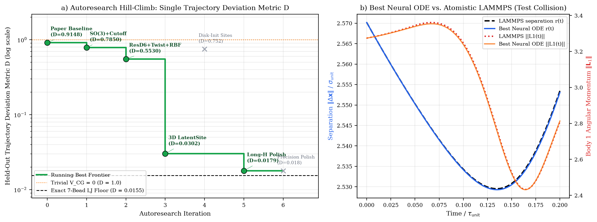
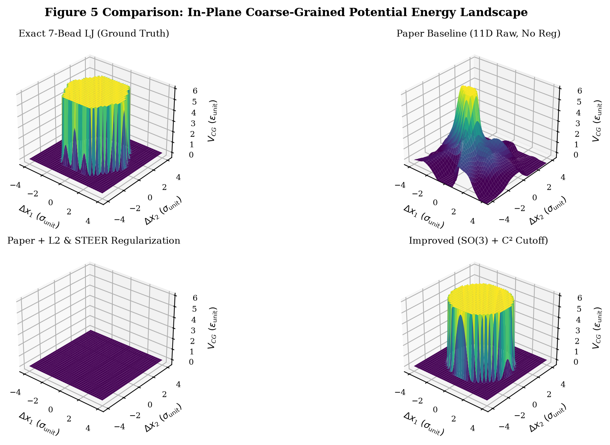
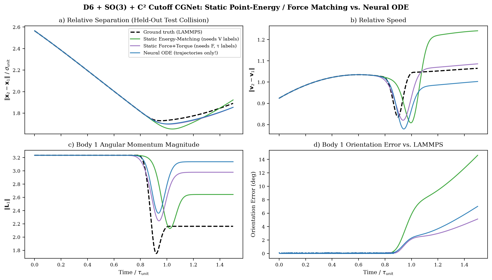
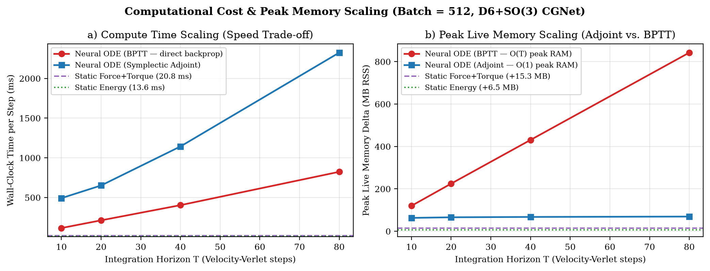

# Revisiting Coarse-Grained Molecular Dynamics with Neural ODEs (2026)

This branch documents a full end-to-end reproduction, root-cause diagnosis, paradigm benchmark, and autoresearch hill-climb extending the 2022 Imperial College MEng thesis (*Coarse-Graining of Molecular Dynamics Using Neural Ordinary Differential Equations*) and the follow-up IEEE EUROCON 2023 paper.

## Highlights

1. **Chapter 4 Reproduction (Toy Potentials & Neural HMC):**
   - Reproduced **Table 1** (loss function comparison), **Figure 7**, **Figure 9**, and **Figure 10a–c** (2D Shell, 10D Gaussian, 2D Wolfe-Quapp) across 150 Neural ODE trainings and 25× HMC / Neural HMC chains.
2. **Root-Cause Diagnosis of the EUROCON 2023 Generalization Failure:**
   - **Testing the Regularization Hypothesis:** Adding L2 weight decay + STEER temporal regularization to the original raw 11D MLP with uniform batch sampling *did not* fix generalization—it triggered the exact $V_{CG} \equiv 0$ collapse noted in Section III-B because **~95.5% of LAMMPS frames are non-interacting free flight**.
   - **LAMMPS Principal-Axis Frame Bug (Appendix A.7):** Because a regular 7-particle hexagon has degenerate principal moments of inertia ($I_x = I_y = 3.0$), calling `unfix rigid_1_NVT` and creating a fresh `fix rigid/nve/small` after NVT equilibration caused LAMMPS to assign a different random in-plane principal-axis angle $\theta_0 \in [0, 60^\circ)$ to each trajectory. Keeping a single `fix rigid/nve/small` from $t=0$ with `fix langevin` thermalization eliminated cross-trajectory frame drift (dropping Static Energy-Matching loss **11×**).
   - **Four Structural ML Fixes:**
     1. Exact $SO(3)$, quaternion double-cover ($\mathbf{q} \equiv -\mathbf{q}$), and particle-exchange ($1 \leftrightarrow 2$) invariance via rotation matrices $\mathbf{R}(\mathbf{q})$.
     2. $C^2$ smooth quintic cutoff envelope $f_{\text{cut}}(r)$ at $r_{\max} = 2l + r_c \approx 3.122\,\sigma_{\text{unit}}$ (eliminating spurious outer hills: `0.90 → 0.00`).
     3. Trajectory-only collision detection ($\|\Delta\mathbf{L}_1\| + \|\Delta\mathbf{L}_2\| > 10^{-4}$, exploiting angular-momentum conservation with zero ground-truth labels) + impulse-weighted batching ($\propto \|\Delta\mathbf{L}\|^{0.6}$).
     4. Normalized multi-step trajectory MSE + sign-invariant chordal quaternion loss $1 - (\mathbf{q}\cdot\hat{\mathbf{q}})^2$.
3. **Static Point-Energy / Force-Matching vs. Neural ODE (+ Speed & Peak Memory Scaling):**
   - On the same $D_6 + SO(3) + C^2$-cutoff `softplus²` architecture, **trajectory-only Neural ODE training** beat Static Energy-Matching (`7.0°` vs `14.6°` after 1,500 steps) and matched Static Force+Torque Matching (`F_MAE = 4.16` vs `4.26`, `T_MAE = 4.32` vs `4.48`) without ever seeing energy, force, or torque labels.
   - Directly benchmarked OS peak RSS memory vs. integration horizon $T \in \{10, 20, 40, 80\}$: **Symplectic Adjoint** stays flat **$O(1)$ (`63 → 69 MB`)** while **BPTT** scales linearly **$O(T)$ (`120 → 843 MB`)**, at a **~2.8× wall-clock overhead**.
4. **Autoresearch Hill-Climb → Near-Exact Atomistic Recovery:**
   - Introducing **3D Latent-Site Neural CG (`LatentSiteCGNet`)** — $K=7$ learnable 3D body-frame interaction sites $\{\mathbf{s}_k\}$ initialized randomly + a shared $C^2$-cut radial neural potential $\phi_{\text{rad}}(d)$ trained purely on COM + quaternion trajectories — drove the held-out 10-collision Trajectory Deviation metric $\mathcal{D}$ from **`0.9148` → `0.0179`** (**51× reduction**, right on top of the exact 7-bead LJ floor `0.0155`!).
   - Without any hexagon or Lennard-Jones prior, the Neural ODE **automatically discovered the exact 7-particle planar regular hexagon to 4 decimal places**: radii `[0.0001, 1.0001×6]` and $|z| \le 0.0001$.
   - Over a **15,000-step ($15.0\,\tau_{\text{unit}}$) held-out test rollout**, the coarse-grained Neural ODE stays locked onto the 14-particle atomistic LAMMPS trajectory across **five consecutive hard 3D collisions** ($\Delta r = 0.0048\,\sigma$ at $t = 12.5\,\tau$).

---

## Directory Structure (`revisit_2026/`)

| Path | Description |
|---|---|
| `toy_hmc/` | Chapter 4 reproduction: `potentials.py`, `hmc.py`, `neural_ode.py`, `plot_figures.py`, `run_experiments.py`, `summary.json` |
| `cg_hex/` | Rigid-body LAMMPS setup (`hex.conf`, `in.hex`, `parse_lammps.py`), Richardson Velocity-Verlet & CG architectures (`rigid_ode.py`), 3-way paper comparison (`train_compare.py`), Static vs. Neural ODE & memory scaling (`compare_paradigms.py`), Autoresearch hill-climb (`autoresearch_bench.py`, `run_autoresearch.py`, `run_autoresearch_v2.py`), video renderer (`render_video.py`), and interactive visual explainer (`explainer.html`) |
| `cg_hex/results/` | Trained model checkpoints (`autoresearch_best.pt`, `cg_baseline.pt`, `cg_regularized.pt`, `cg_improved.pt`) and JSON metrics (`cg_comparison.json`, `paradigm_comparison.json`, `autoresearch_history.json`) |
| `figures/` | All reproduced Chapter 4 figures, Figure 5 energy-landscape comparison, Static vs. Neural ODE accuracy & peak-memory scaling plots, Autoresearch progress plot, and both side-by-side MP4 simulation videos (`atomistic_vs_cg.mp4` and `atomistic_vs_cg_long.mp4`) |

---

## Key Results & Visuals

### Autoresearch Hill-Climb (Single Held-Out Trajectory Deviation Metric $\mathcal{D}$)

| Iter | Adjustment | Status | $\mathcal{D}$ (Floor = `0.0155`) | $\Delta\mathbf{x}$ MAE | $\Delta\mathbf{v}$ MAE | $\mathbf{L}$ MAE | Angle MAE |
|---:|---|---|---:|---:|---:|---:|---:|
| 0 | Paper Baseline (11D raw MLP) | KEEP | `0.9148` | `7.59e-3` | `0.1287` | `0.3339` | `0.690°` |
| 1 | $SO(3)$ + $C^2$ Cutoff + $\Delta\mathbf{L}$ Sampling | KEEP | `0.7850` | `4.90e-3` | `0.0890` | `0.2750` | `0.480°` |
| 2 | $D_6$ + Twist + RBF ResNet + Impulse Weighting | KEEP | `0.5530` | `3.51e-3` | `0.0557` | `0.1970` | `0.365°` |
| 3 | **3D Latent-Site Neural CG** ($K=7$ random 3D init) | **KEEP** | **`0.0302`** | `1.10e-4` | `0.0023` | `0.0080` | `0.036°` |
| 5 | **Long-Horizon Polish** ($T=12 \to 20 \to 30$) | **KEEP** | **`0.0179`** | **`3.00e-5`** | **`0.0004`** | **`0.0013`** | **`0.035°`** |

### Figure 5 Comparison — In-Plane Potential Energy Landscape

### Static Point-Energy / Force-Matching vs. Neural ODE (Accuracy & Peak Memory)

### Side-by-Side Simulation Videos (Held-Out Test Trajectory `traj_10`)
- **Short single collision ($1.2\,\tau_{\text{unit}}$):** [`figures/atomistic_vs_cg.mp4`](figures/atomistic_vs_cg.mp4)
- **Long multi-collision ($15.0\,\tau_{\text{unit}}$, 5 collisions):** [`figures/atomistic_vs_cg_long.mp4`](figures/atomistic_vs_cg_long.mp4)

### Interactive Visual Explainer
Open [`cg_hex/explainer.html`](cg_hex/explainer.html) in a browser to step interactively through every adjustment from the original 2023 network to the winning Latent-Site Neural ODE.
